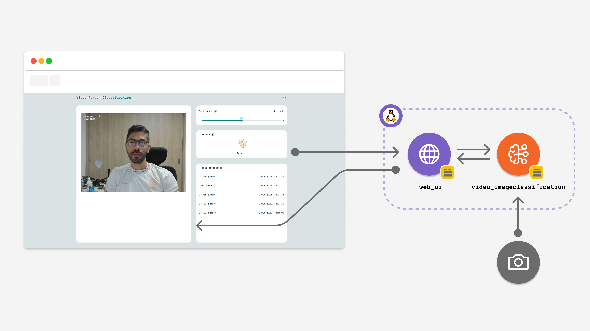
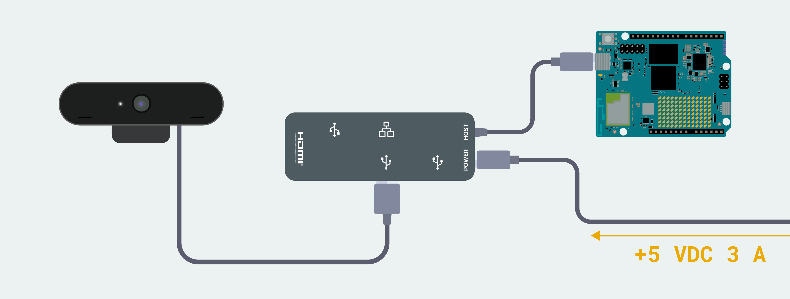

# 人検知LED（Arduino UNO Q）

カメラに人が映ったら、Arduino UNO Q に付いている LED が赤くなるアプリです。誰もいないときは緑に戻ります。ブラウザの画面でも、判定の結果と履歴が見られます。



## 制作背景

UNO Q には、Linux が動く CPU とマイコンが 1 枚のボードに両方載っています。せっかくなら「AI の処理」と「LED のようなハードの制御」を両方やってみたいと思ったのが始まりでした。

まず Arduino App Lab の公式サンプル「Person Classifier on Camera」を動かしてみたところ、カメラで人を判定して画面に出すところまでは最初からできていました。ただ、結果は画面を見ないと分かりません。コードを読んでいくと、人を見つけたときに呼ばれる関数があり、中身は `pass` だけで「ここに処理を書いてね」という状態でした。

そこで、この空いていた所に LED の処理を足すことにしました。ボードに最初から付いている RGB LED を使えば部品を追加しなくて済み、離れたところからでも人がいるかどうかが分かります。

作っている途中で、このサンプルは「画像分類」で、画像全体に人が写っているかどうかしか分からないことも知りました。体や顔を見つけているわけではないので、人の位置や人数までは分かりません。

## サンプルから変えたところ

- `person_detected()` は空っぽだったので、人を見つけた時刻を記録するようにしました
- LED を切り替えるスレッドを Python 側に追加しました
- マイコン側のスケッチ（`sketch.ino`）は新しく書きました
- 画面への送信を 0.5 秒に 1 回に減らしました。毎フレーム送ると通信と描き直しが多くて重くなるためです。LED の判定は毎フレームのままなので、反応は遅くなりません
- `app.js` は、重複していた処理をまとめ、使っていない関数を消して、281 行から 162 行にしました。日付は日本式で出るようにしています
- 画面の文字を日本語にしました

## LED の動き

人が映るとすぐ赤になり、映らなくなってから 1 秒たつと緑に戻ります。すぐ戻さないのは、AI が一瞬見失っただけで LED がチカチカするのを防ぐためです。

流れはこうなっています。

1. 人を見つけたら、その時刻を記録する（`main.py`）
2. 別のスレッドが 0.1 秒ごとに「最後に見つけてから 1 秒以内か」を確認する
3. 色が変わるときだけ、`Bridge.call("set_led_state", ...)` でマイコンに伝える
4. マイコンが LED の色を変える（`sketch.ino`）

```
カメラ → AI で判定（Python）─┬─ Bridge ──→ マイコン → LED（赤 / 緑）
                             └─ WebSocket → ブラウザの画面
```

戻るまでの秒数は `main.py` の `LED_OFF_DELAY_SEC`、画面への送信間隔は `UI_SEND_INTERVAL_SEC` で変えられます。LED の色は `sketch.ino` の `set_led_state()` の 1 行を書き換えれば変えられます。

## 使ったもの

- Arduino UNO Q（メモリ 2GB）
- USB カメラ
- 電源付きの USB-C ハブ（UNO Q に USB カメラをつなぐのに必要です）
- モニター・キーボード・マウス
- Arduino App Lab

## 動かし方

1. 電源付きの USB-C ハブを通して、カメラを UNO Q につなぎます。

   

2. Arduino App Lab でこのアプリを開いて実行します。
3. ブラウザで画面が開きます。開かないときは `<ボード名>.local:7000` にアクセスしてください。ボードにモニターをつないでいる場合は `127.0.0.1:7000` でも開けます。
4. カメラの前に立つと LED が赤くなり、画面に「人を検知しました！」と出ます。

App Lab はネットワークモードか、ボードを単体のコンピュータとして使うモード（SBC モード）で使ってください。

## 画面の見方

- 左側：カメラの映像
- 信頼度のしきい値：どのくらい確かなら「人」とみなすかを決めるスライダーです。初期値は 0.50 で、下げると反応しやすくなるかわりに誤検知も増えます
- 検知状況：人がいると手を振る絵と「人を検知しました！」が出ます。ちらつかないよう、切り替えは最短 2 秒おきにしています
- 最近の検知結果：直近 5 回分を「93.4% - 人」のように時刻つきで並べます

## ファイル

```
app.yaml          アプリの設定（使う Brick と AI モデル）
python/main.py    人の判定、LED の制御、画面への送信
sketch/           マイコン側のスケッチ
assets/           ブラウザの画面（HTML / JS / CSS）
```

## 今後やりたいこと

- 暗い場所や、遠くにいる人でも検知できるか試す
- 画像分類ではなく物体検出を使って、人の位置や人数も分かるようにする
- 人を見つけたらブザーを鳴らす、スマホに通知するなど、機能を足す

## ライセンス

元にした Arduino のサンプルは MPL-2.0 です。各ファイルの先頭に表記があります。
